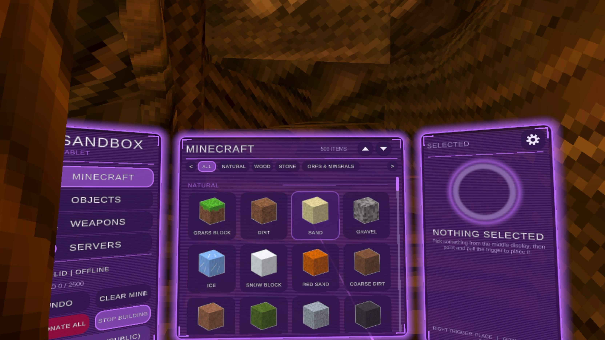

# Unknowns Sandbox UI
Unknowns Sandbox UI is a mod for the virtual reality game Gorilla Tag which introduces a sandbox-based menu inspired by Gary's Mod and MonoSandbox.

## Features!
- A simplistic menu which makes for easy interaction
- A variety of different items with unique mechanics
- A polished experience used by hundreds of players
- Amazing, polished, well designed ect.

### <i>This product is not affiliated with Gorilla Tag or Another Axiom LLC and is not endorsed or otherwise sponsored by Another Axiom LLC. Portions of the materials contained herein are property of Another Axiom LLC. ©2021 Another Axiom LLC.</i>

  

